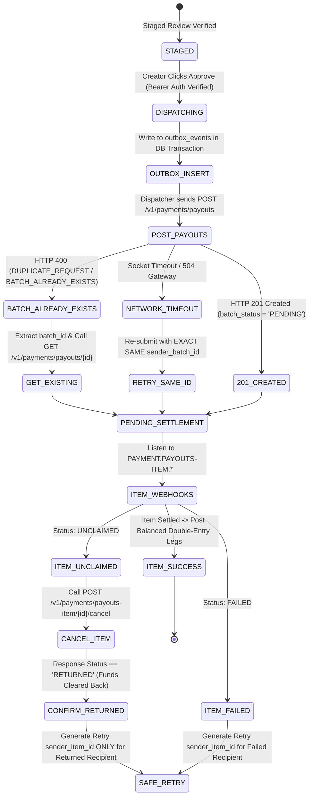

# SplitFlow AI — Production-Grade Implementation Plan (v3.3)

> **Document Version:** 3.3.0 (Hardened Production & Fault-Tolerant Engine)  
> **Target Platform:** PayPal Developer Platform & Multi-Modal AI  
> **Domain:** Agentic Commerce / Creator & Freelancer Cross-Border Finance  
> **Financial Precision Standard:** Multi-Currency Minor Units (ISO 4217), Strict Double-Entry, Zero Floating-Point Math  
> **Reliability Standard:** Decoupled I/O (Short DB Transactions), Resilient Webhook Retry Worker, Database Balance Verification  

---

## Table of Contents
1. [Core Financial Foundation & Cumulative Allocation Model](#1-core-financial-foundation--cumulative-allocation-model)
2. [End-to-End System Architecture](#2-end-to-end-system-architecture)
3. [Component 1: Multi-Facet Contract Change Detection & Versioning](#3-component-1-multi-facet-contract-change-detection--versioning)
4. [Component 2: Invoice Payment Resource Verification & Traversal](#4-component-2-invoice-payment-resource-verification--traversal)
5. [Component 3: Decoupled I/O, Webhook Retry Worker & Atomic Staging](#5-component-3-decoupled-io-webhook-retry-worker--atomic-staging)
6. [Component 4: Multi-Currency Double-Entry Ledger with Balance Verification](#6-component-4-multi-currency-double-entry-ledger-with-balance-verification)
7. [Component 5: PayPal Payouts State Machine & RETURNED Item Safety](#7-component-5-paypal-payouts-state-machine--returned-item-safety)
8. [Component 6: Deterministic Financial Copilot & Risk Engine](#8-component-6-deterministic-financial-copilot--risk-engine)
9. [Complete Production Database Schema (SQL DDL)](#9-complete-production-database-schema-sql-ddl)
10. [Multi-Tenant Security, Session Auth (RBAC) & Audit Trails](#10-multi-tenant-security-session-auth-rbac--audit-trails)
11. [PayPal Developer Platform Integration & Response Traversal](#11-paypal-developer-platform-integration--response-traversal)
12. [Sandbox Topology & Verification Matrix](#12-sandbox-topology--verification-matrix)
13. [Phase-by-Phase Sprint Execution Plan](#13-phase-by-phase-sprint-execution-plan)
14. [Winning 3-Minute Demo Script & Storyboard](#14-winning-3-minute-demo-script--storyboard)

---

## 1. Core Financial Foundation & Cumulative Allocation Model

### 1.1 The Exact Creator Remainder Formula
The creator's remainder is strictly computed by subtracting **all** collaborator allocations—including both fixed flat fees and percentage-based allocations—from the actual net funds received after PayPal inbound fees:

$$\text{Creator Remainder} = \text{Actual Net Received} - \left( \sum \text{Fixed Fee Allocations} + \sum \text{Percentage Allocations} \right)$$

$$\sum \text{Fixed Fees} + \sum \text{Percentage Allocations} + \text{Creator Remainder} \equiv \text{Actual Net Received}$$

This guarantees that:
1. Every unit received is completely and deterministically accounted for.
2. The creator absorbs odd rounding units.
3. Collaborator payouts can never overdraft the net cleared balance.

---

### 1.2 Strict Currency-Specific Minor Units (ISO 4217) — No Silent Fallback
SplitFlow rejects assumptions of two decimal places. If an incoming currency is not explicitly mapped, the system **rejects processing with an explicit `UnsupportedCurrencyError`**, preventing silent data corruption:

```python
from decimal import Decimal, ROUND_HALF_UP

# Exhaustive Supported ISO 4217 Currency Exponent Registry
CURRENCY_MINOR_UNITS: dict[str, int] = {
    # 2 Decimals (Standard)
    "USD": 2, "EUR": 2, "GBP": 2, "PHP": 2, "BRL": 2,
    "CAD": 2, "AUD": 2, "SGD": 2, "HKD": 2, "NZD": 2,
    # 0 Decimals (Zero-exponent currencies)
    "JPY": 0, "KRW": 0, "VND": 0, "CLP": 0, "PYG": 0,
    # 3 Decimals (Three-exponent currencies)
    "KWD": 3, "BHD": 3, "OMR": 3, "JOD": 3, "TND": 3
}

class UnsupportedCurrencyError(ValueError):
    """Raised when an unmapped or invalid ISO 4217 currency is encountered."""
    pass

def get_currency_decimals(currency: str) -> int:
    curr_clean = currency.upper().strip()
    if curr_clean not in CURRENCY_MINOR_UNITS:
        raise UnsupportedCurrencyError(
            f"Currency '{curr_clean}' is not supported by SplitFlow. "
            f"Explicit minor unit configuration required. Supported: {list(CURRENCY_MINOR_UNITS.keys())}"
        )
    return CURRENCY_MINOR_UNITS[curr_clean]

def to_minor_units(amount_str: str, currency: str) -> int:
    """Converts a decimal string amount into integer minor units with zero float math."""
    decimals = get_currency_decimals(currency)
    multiplier = Decimal(10) ** decimals
    return int((Decimal(amount_str) * multiplier).quantize(Decimal("1"), rounding=ROUND_HALF_UP))

def from_minor_units(minor_units: int, currency: str) -> str:
    """Formats integer minor units into standard currency string representation."""
    decimals = get_currency_decimals(currency)
    divisor = Decimal(10) ** decimals
    return f"{Decimal(minor_units) / divisor:.{decimals}f}"
```

---

### 1.3 Cumulative Multi-Capture Allocation Engine
Real clients frequently pay milestones in multiple partial installments. SplitFlow handles each capture independently and allocates funds cumulatively across milestone rules:

#### The Cumulative Allocation Rules:
1. **Fixed Flat Fees:** Deducted on a first-dollar priority basis until the milestone's total flat fee obligation is fully satisfied. Subsequent captures allocate \$0 toward flat fees.
2. **Percentage Allocations:** Apply strictly to the net funds remaining after deducting any flat fees satisfied by that specific capture.
3. **Cumulative Protection:** An allocation record is persisted in `milestone_allocations` for every capture. Total cumulative collaborator payouts cannot exceed the total contractual entitlement.

#### Concrete Multi-Capture Walkthrough:
* **Contract Milestone 1:** \$2,500.00 expected (`250000` cents).
* **Rules:** Designer gets \$300.00 flat (`30000` cents); Editor gets 20% of net pool.

```
CAPTURE 1 (Client Partial Payment: $1,000.00 Gross, $35.39 Inbound Fee, $964.61 Net Cleared)
------------------------------------------------------------------------------------------------
1. Net Received:                         96461 cents ($964.61)
2. Flat Fee Satisfied (Designer):        30000 cents ($300.00)  [Flat fee now 100% satisfied]
3. Remaining Net Pool for %:             66461 cents ($664.61)
4. Editor Allocation (20% of 66461):     13292 cents ($132.92)
5. Creator Remainder (96461 - 30000 - 13292): 53169 cents ($531.69)
   Check: 30000 + 13292 + 53169 == 96461 cents. Verified.

CAPTURE 2 (Client Balance Payment: $1,500.00 Gross, $52.84 Inbound Fee, $1,447.16 Net Cleared)
------------------------------------------------------------------------------------------------
1. Net Received:                         144716 cents ($1,447.16)
2. Flat Fee Satisfied (Designer):             0 cents ($0.00)    [Already 100% satisfied]
3. Remaining Net Pool for %:             144716 cents ($1,447.16)
4. Editor Allocation (20% of 144716):    28943 cents ($289.43)
5. Creator Remainder (144716 - 0 - 28943): 115773 cents ($1,157.73)
   Check: 0 + 28943 + 115773 == 144716 cents. Verified.

CUMULATIVE AUDIT OVER TOTAL MILESTONE ($2,411.77 Total Net Cleared)
------------------------------------------------------------------------------------------------
Total Flat Fees Disbursed (Designer):     30000 cents ($300.00)
Total Percentage Disbursed (Editor):      42235 cents ($422.35)
Total Creator Net Retained:              168942 cents ($1,689.42)
Sum Total: 30000 + 42235 + 168942 == 241177 cents ($2,411.77). 100% Balanced.
```

---

## 2. End-to-End System Architecture

```mermaid
flowchart TB
    subgraph INGESTION["1. Document Ingestion & Contract Intelligence"]
        PDF[Brand Sponsorship SOW / PDF] --> PYMUPDF[PyMuPDF: Character Runs & Coordinates]
        PYMUPDF --> PARSE_CODE[Deterministic Python Section & Term Parser]
        PARSE_CODE --> LLM_MAP[LLM: Match Entities to Pre-Verified Directory]
        PARSE_CODE --> SUBSTRING_VAL{Verbatim Substring & Value Matcher}
        SUBSTRING_VAL -- Valid --> DOC_HASH[Compute SHA-256 Hash Scoped to (creator_id, contract_id)]
        SUBSTRING_VAL -- Invalid --> RED_FLAG[Flag Red UI Warning: Manual Review Required]
    end

    subgraph VERSIONING["2. Change Detection & Invoice Lifecycle"]
        DOC_HASH --> DIFF_ENGINE{Python Code-Level Terms Diff vs Previous Version}
        DIFF_ENGINE -- Terms Modified --> LLM_NARRATIVE[LLM: Generate Human Diff Narrative]
        LLM_NARRATIVE --> REAPPROVE[Set requires_reapproval = TRUE & Lock Staging]
        DIFF_ENGINE -- No Change / Reapproved --> INV_DISPATCH[PayPal Invoicing v2: Create Draft/Send]
    end

    subgraph DECOUPLED_WEBHOOK["3. Decoupled Webhook Ingestion & Worker Pipeline"]
        CLIENT[Brand Client Pays Invoice] --> PAYPAL_GW[PayPal Gateway]
        PAYPAL_GW --> WH_RECV[Webhook: INVOICING.INVOICE.PAID]
        WH_RECV --> SIG_VAL{verify_paypal_signature}
        SIG_VAL -- Valid --> FAST_DB1[Short DB Tx 1: Check Event Status]
        FAST_DB1 --> STATUS_CHECK{Event State?}
        STATUS_CHECK -- PROCESSED --> RET200[Return 200 OK: Ignore Already Processed]
        STATUS_CHECK -- PROCESSING --> RET_INFLIGHT[Return 200 OK: In-Flight Concurrency Guard]
        STATUS_CHECK -- NEW or FAILED_RETRYABLE --> ACQUIRE[Acquire PROCESSING Lock & Commit Tx 1]
        
        ACQUIRE --> EXT_IO[External Network I/O: NO DB LOCK HELD]
        EXT_IO --> FETCH_INV[GET /v2/invoicing/invoices/id -> Traverse payments.transactions]
        FETCH_INV --> VALIDATE_TX{tx.type == 'PAYPAL' and payment_id verified capture?}
        VALIDATE_TX -- Yes --> FETCH_CAP[GET /v2/payments/captures/id -> Extract Breakdown]
        FETCH_CAP --> FAST_DB2[Short DB Tx 2: Persist Captures & Staged Payouts]
    end

    subgraph ALLOCATION["4. Cumulative Staging & Approval"]
        FAST_DB2 --> CUM_CALC[Calculate Cumulative Splits in Minor Units]
        CUM_CALC --> HASH_PAYLOAD[Generate Complete SHA-256 Payout Hash]
        HASH_PAYLOAD --> STAGED_UI[Display Staged Review with Verified Directory Emails]
        STAGED_UI --> CREATOR_AUTH{Creator Approval with Expiring Session Bearer Token}
    end

    subgraph SETTLEMENT["5. Safe Settlement & Double-Entry Ledger"]
        CREATOR_AUTH -- Approved --> SAFE_PAYOUT[Dispatch Batch: sender_batch_id + sender_item_id]
        SAFE_PAYOUT --> OUTBOX[Transactional Outbox Pattern]
        OUTBOX --> PAYPAL_EXEC[POST /v1/payments/payouts]
        PAYPAL_EXEC -- 400 BATCH_ALREADY_EXISTS --> RECOVER_BATCH[GET /v1/payments/payouts/batch_id]
        PAYPAL_EXEC -- Success / Recovered --> ITEM_WH[PAYMENT.PAYOUTS-ITEM.* Handler]
        ITEM_WH -- UNCLAIMED --> CANCEL_ITEM[POST /v1/payments/payouts-item/id/cancel]
        CANCEL_ITEM --> CONFIRM_RETURNED[Confirm Status == 'RETURNED' before Retry]
        ITEM_WH -- SUCCESS --> DOUBLE_ENTRY[Post Balanced Journal Legs in Minor Units]
        DOUBLE_ENTRY --> TRIGGER_CHECK{SQLite Trigger: Check Debits == Credits}
        TRIGGER_CHECK -- Balanced --> COMMIT_LEDGER[Commit Immutable Ledger]
        COMMIT_LEDGER --> CSV_EXPORT[Schedule-C CSV Export: Not Tax Advice]
        COMMIT_LEDGER --> COPILOT[Read-Only Copilot & Contract Risk Analyzer]
    end
```

---

## 3. Component 1: Multi-Facet Contract Change Detection & Versioning

### 3.1 Multi-Facet Diff Engine (Beyond Milestone Amounts)
Contract amendments often alter non-monetary clauses that dramatically affect financial risk. SplitFlow’s deterministic Python diff engine tracks 6 distinct contractual dimensions:

```python
def compute_complete_contract_diff(v_prev: dict, v_next: dict) -> dict:
    """
    Deterministically computes differences across financial and legal dimensions.
    """
    diff = {
        "currency_changed": v_prev.get("currency") != v_next.get("currency"),
        "net_terms_changed": v_prev.get("payment_terms_days") != v_next.get("payment_terms_days"),
        "milestones_modified": [],
        "deadlines_shifted": [],
        "cancellation_terms_altered": v_prev.get("cancellation_clause") != v_next.get("cancellation_clause"),
        "exclusivity_altered": v_prev.get("exclusivity_clause") != v_next.get("exclusivity_clause"),
        "has_material_risk": False
    }

    prev_m = {m["number"]: m for m in v_prev.get("milestones", [])}
    next_m = {m["number"]: m for m in v_next.get("milestones", [])}

    for num, m_new in next_m.items():
        if num in prev_m:
            m_old = prev_m[num]
            if m_new["amount_minor_units"] != m_old["amount_minor_units"]:
                diff["milestones_modified"].append({
                    "milestone_number": num,
                    "old_minor": m_old["amount_minor_units"],
                    "new_minor": m_new["amount_minor_units"]
                })
            if m_new["due_date"] != m_old["due_date"]:
                diff["deadlines_shifted"].append({
                    "milestone_number": num,
                    "old_date": m_old["due_date"],
                    "new_date": m_new["due_date"]
                })

    diff["has_material_risk"] = bool(
        diff["currency_changed"] or
        diff["net_terms_changed"] or
        diff["milestones_modified"] or
        diff["cancellation_terms_altered"]
    )
    return diff
```

---

## 4. Component 2: Invoice Payment Resource Verification & Traversal

### 4.1 Do Not Assume `payment_id` is a Capture ID
In the PayPal Invoicing v2 API, `payments.transactions[]` contains records for various payment methods. Crucially:
1. `tx.type == "EXTERNAL"`: The merchant manually marked an offline payment (cash, check, external wire). **No PayPal capture endpoint exists for external records.** Calling `/v2/payments/captures/{id}` returns HTTP 404.
2. `tx.type == "PAYPAL"`: The payment was executed on PayPal rails. However, the `payment_id` must be verified as a valid capture resource before attempting fee breakdown parsing.

```python
def extract_and_verify_invoice_captures(invoice_data: dict, paypal_client) -> list[dict]:
    """
    Traverses payments.transactions[] and verifies each payment resource before ingestion.
    """
    payments = invoice_data.get("payments", {})
    transactions = payments.get("transactions", [])
    verified_captures = []

    for tx in transactions:
        tx_type = tx.get("type")
        payment_id = tx.get("payment_id")
        
        # 1. Reject or bypass external offline records
        if tx_type != "PAYPAL":
            logger.info(f"Skipping non-PayPal payment transaction {payment_id} (Type: {tx_type})")
            continue
            
        if not payment_id:
            logger.warning(f"Malformed transaction missing payment_id: {tx}")
            continue

        # 2. Verify actual PayPal capture resource
        try:
            capture_data = paypal_client.get_capture(payment_id)
        except PayPalAPIError as e:
            if e.status_code == 404:
                logger.error(f"payment_id {payment_id} is not a valid Capture resource. Skipping.")
                continue
            raise  # Network or auth error; allow retry worker to handle

        # 3. Verify capture status is terminal COMPLETED
        if capture_data.get("status") != "COMPLETED":
            logger.warning(f"Capture {payment_id} is in non-terminal status: {capture_data.get('status')}")
            continue

        breakdown = capture_data.get("seller_receivable_breakdown", {})
        currency = breakdown.get("net_amount", {}).get("currency_code") or breakdown.get("net_amount", {}).get("currency")
        
        if not currency:
            raise ValueError(f"Capture {payment_id} missing currency code in seller_receivable_breakdown")

        # Validate currency against ISO 4217 registry (throws UnsupportedCurrencyError if unmapped)
        gross_minor = to_minor_units(breakdown.get("gross_amount", {}).get("value", "0.00"), currency)
        fee_minor = to_minor_units(breakdown.get("paypal_fee", {}).get("value", "0.00"), currency)
        net_minor = to_minor_units(breakdown.get("net_amount", {}).get("value", "0.00"), currency)

        verified_captures.append({
            "capture_id": payment_id,
            "currency": currency,
            "gross_minor": gross_minor,
            "fee_minor": fee_minor,
            "net_minor": net_minor,
            "captured_at": capture_data.get("create_time")
        })

    return verified_captures
```

---

## 5. Component 3: Decoupled I/O, Webhook Retry Worker & Atomic Staging

### 5.1 Decoupled I/O: Never Hold Database Locks During Network Calls
Holding open a database connection during remote HTTP requests to PayPal causes connection pool exhaustion and transaction lock timeouts. SplitFlow cleanly decouples external I/O from database transactions:

```python
@router.post("/api/webhooks/paypal", status_code=status.HTTP_200_OK)
async def handle_paypal_webhook(request: Request, db: Session = Depends(get_db)):
    raw_body = await request.body()
    body_str = raw_body.decode("utf-8")
    payload = json.loads(body_str)

    # 1. Signature Verification (Pure in-memory/crypto, no DB lock)
    if not verify_paypal_signature(request.headers, body_str):
        raise HTTPException(status_code=400, detail="Invalid signature")

    event_id = payload.get("id")
    event_type = payload.get("event_type")

    # =========================================================================
    # TRANSACTION 1: Quick Lock & Status Gate (Duration: ~2ms)
    # =========================================================================
    should_process = False
    with db.begin():
        event = db.query(WebhookEvent).filter_by(event_id=event_id).with_for_update().first()
        
        if not event:
            # First time seeing event
            event = WebhookEvent(event_id=event_id, event_type=event_type, status="PROCESSING", retry_count=0)
            db.add(event)
            should_process = True
        elif event.status == "PROCESSED":
            # Already completed; acknowledge and ignore
            return {"status": "ignored", "reason": "already_processed"}
        elif event.status == "PROCESSING":
            # Active in-flight worker already executing; prevent race condition
            return {"status": "in_flight", "reason": "concurrent_worker_active"}
        elif event.status in ["FAILED_RETRYABLE", "RECEIVED"]:
            # Eligible for retry!
            event.status = "PROCESSING"
            event.retry_count += 1
            should_process = True
        else: # FAILED_TERMINAL
            return {"status": "rejected", "reason": "terminal_failure"}

    if not should_process or event_type != "INVOICING.INVOICE.PAID":
        return {"status": "ok"}

    # =========================================================================
    # EXTERNAL NETWORK I/O: NO DATABASE LOCK HELD (Duration: ~300ms - 1500ms)
    # =========================================================================
    invoice_id = payload.get("resource", {}).get("invoice", {}).get("id")
    try:
        invoice_data = paypal_client.get_invoice(invoice_id)
        verified_captures = extract_and_verify_invoice_captures(invoice_data, paypal_client)
    except Exception as exc:
        # Mark FAILED_RETRYABLE in a separate short transaction
        with db.begin():
            db.query(WebhookEvent).filter_by(event_id=event_id).update({
                "status": "FAILED_RETRYABLE",
                "error_message": f"External I/O failed: {str(exc)}"
            })
        logger.error(f"PayPal API network failure for event {event_id}: {exc}")
        return {"status": "retry_scheduled"}

    # =========================================================================
    # TRANSACTION 2: Atomic Persistence & Staging (Duration: ~5ms)
    # =========================================================================
    with db.begin():
        milestone = db.query(Milestone).filter_by(paypal_invoice_id=invoice_id).first()
        
        for cap in verified_captures:
            # Atomic Capture Deduplication
            stmt_l2 = (
                insert(PaymentCapture)
                .values(
                    capture_id=cap["capture_id"],
                    invoice_id=invoice_id,
                    gross_minor_units=cap["gross_minor"],
                    fee_minor_units=cap["fee_minor"],
                    net_minor_units=cap["net_minor"],
                    currency=cap["currency"]
                )
                .on_conflict_do_nothing(index_elements=["capture_id"])
            )
            res_l2 = db.execute(stmt_l2)
            if res_l2.rowcount == 0:
                continue  # Capture already processed in previous partial batch

            # Reconciliation Record
            recon_status = "EXACT_MATCH" if cap["gross_minor"] == milestone.expected_amount_minor_units else "NEEDS_REVIEW"
            db.add(ReconciliationResult(
                capture_id=cap["capture_id"],
                milestone_id=milestone.id,
                status=recon_status,
                expected_minor_units=milestone.expected_amount_minor_units,
                actual_minor_units=cap["gross_minor"]
            ))

            # Cumulative Split Calculations (Deterministic Python Math)
            staging_key = f"stage_{milestone.id}_{cap['capture_id']}"
            staged_items, total_payout_minor, creator_remainder_minor = calculate_cumulative_splits(
                milestone=milestone,
                capture_net_minor=cap["net_minor"],
                currency=cap["currency"],
                db=db
            )

            state_hash = compute_payout_state_hash(staged_items, staging_key)

            stmt_l3 = (
                insert(StagedPayoutBatch)
                .values(
                    staging_key=staging_key,
                    creator_id=milestone.creator_id,
                    milestone_id=milestone.id,
                    capture_id=cap["capture_id"],
                    state_hash=state_hash,
                    total_payout_minor_units=total_payout_minor,
                    creator_remainder_minor_units=creator_remainder_minor,
                    status="STAGED"
                )
                .on_conflict_do_nothing(index_elements=["staging_key"])
            )
            res_l3 = db.execute(stmt_l3)
            if res_l3.rowcount == 0:
                continue

            for item in staged_items:
                db.add(StagedPayoutItem(
                    staging_key=staging_key,
                    collaborator_id=item["collaborator_id"],
                    sender_item_id=f"{staging_key}_{item['collaborator_id']}",
                    verified_email=item["verified_email"],
                    amount_minor_units=item["amount_minor"],
                    currency=cap["currency"]
                ))

        # Successfully finished all captures
        db.query(WebhookEvent).filter_by(event_id=event_id).update({
            "status": "PROCESSED",
            "error_message": None
        })

    return {"status": "success"}
```

---

## 6. Component 4: Multi-Currency Double-Entry Ledger with Balance Verification

### 6.1 Transaction-Level Ledger Balance Trigger
Instead of an unconditional error trigger, SplitFlow introduces a **two-phase posting flow** with a true SQLite trigger that mathematically verifies debits equal credits upon committing:

```sql
-- Trigger: Verifies debits == credits when journal entry is marked posted
CREATE TRIGGER verify_journal_entry_balance_on_post
BEFORE UPDATE OF is_posted ON journal_entries
FOR EACH ROW
WHEN NEW.is_posted = 1 AND OLD.is_posted = 0
BEGIN
    SELECT CASE
        -- Check 1: Sum of Debits minus Sum of Credits must equal exactly 0
        WHEN (
            SELECT COALESCE(SUM(debit_minor_units), 0) - COALESCE(SUM(credit_minor_units), 0)
            FROM journal_legs
            WHERE journal_entry_id = NEW.id
        ) != 0
        THEN RAISE(ABORT, 'Financial Integrity Violation: Journal entry debits and credits do not balance.')
        
        -- Check 2: Minimum of 2 legs required for double-entry validity
        WHEN (
            SELECT COUNT(*)
            FROM journal_legs
            WHERE journal_entry_id = NEW.id
        ) < 2
        THEN RAISE(ABORT, 'Double-Entry Violation: Journal entry must contain at least two journal legs.')
    END;
END;
```

### 6.2 Python Atomic Ledger Posting Utility
```python
class UnbalancedLedgerError(ValueError):
    pass

def post_balanced_journal_entry(
    db: Session,
    creator_id: int,
    reference_id: str,
    currency: str,
    narration: str,
    legs: list[dict]  # [{"account_code": "1010", "debit": 241226, "credit": 0}, ...]
) -> JournalEntry:
    """
    Guarantees balanced debits and credits in Python before firing the database trigger.
    """
    total_debit = sum(leg.get("debit", 0) for leg in legs)
    total_credit = sum(leg.get("credit", 0) for leg in legs)
    
    if total_debit != total_credit:
        raise UnbalancedLedgerError(
            f"Cannot post unbalanced journal entry {reference_id}: "
            f"Total Debits ({total_debit}) != Total Credits ({total_credit})"
        )
    if len(legs) < 2:
        raise UnbalancedLedgerError("Double-entry accounting requires at least 2 legs.")

    # 1. Insert unposted journal entry
    entry = JournalEntry(
        creator_id=creator_id,
        reference_id=reference_id,
        currency=currency,
        narration=narration,
        is_posted=False
    )
    db.add(entry)
    db.flush()  # Generates entry.id

    # 2. Insert legs
    for leg in legs:
        db.add(JournalLeg(
            journal_entry_id=entry.id,
            account_code=leg["account_code"],
            debit_minor_units=leg.get("debit", 0),
            credit_minor_units=leg.get("credit", 0)
        ))
    db.flush()

    # 3. Post entry (fires the verify_journal_entry_balance_on_post trigger)
    entry.is_posted = True
    entry.posted_at = datetime.utcnow()
    db.flush()
    return entry
```

---

## 7. Component 5: PayPal Payouts State Machine & RETURNED Item Safety



### Unclaimed Cancellation Rules:
* When an unclaimed payout item is canceled via `POST /v1/payments/payouts-item/{payout_item_id}/cancel`, PayPal transitions the item status to **`RETURNED`** (never `CANCELED`).
* Funds return to the sender's PayPal balance. The ledger posts:
  * `DR 1010 PayPal Cash Balance`
  * `CR 2010 Collaborator Payouts Payable`
* Only after the database logs `status = 'RETURNED'` may the creator stage a new targeted payout attempt.

---

## 8. Component 6: Deterministic Financial Copilot & Risk Engine

```python
COPILOT_TOOLS = [
    {
        "name": "list_collaborators",
        "description": "Returns a list of all active collaborators for the creator, their IDs, roles, and verified emails.",
        "parameters": {"type": "object", "properties": {}}
    },
    {
        "name": "find_contract_by_client",
        "description": "Finds contracts matching a client query and returns contract IDs.",
        "parameters": {
            "type": "object",
            "properties": {"client_query": {"type": "string"}},
            "required": ["client_query"]
        }
    },
    {
        "name": "get_contract_financial_summary",
        "description": "Returns deterministic gross invoiced, inbound fees, collaborator payouts, outbound fees, and net retained earnings in minor units and formatted strings.",
        "parameters": {
            "type": "object",
            "properties": {"contract_id": {"type": "integer"}},
            "required": ["contract_id"]
        }
    },
    {
        "name": "analyze_contract_risk_terms",
        "description": "Evaluates contract terms for cash flow risks, long payment windows (Net-60+), kill-fee terms, and currency exposure.",
        "parameters": {
            "type": "object",
            "properties": {"contract_id": {"type": "integer"}},
            "required": ["contract_id"]
        }
    }
]
```

---

## 9. Complete Production Database Schema (SQL DDL)

```sql
PRAGMA foreign_keys = ON;

-- ============================================================================
-- 1. MULTI-TENANT CREATORS & SESSIONS
-- ============================================================================
CREATE TABLE creators (
    id INTEGER PRIMARY KEY AUTOINCREMENT,
    business_name VARCHAR(150) NOT NULL,
    email VARCHAR(255) NOT NULL UNIQUE,
    paypal_merchant_id VARCHAR(100) UNIQUE,
    created_at TIMESTAMP DEFAULT CURRENT_TIMESTAMP
);

CREATE TABLE user_sessions (
    id VARCHAR(100) PRIMARY KEY,                -- Secure signed session token
    creator_id INTEGER NOT NULL,
    role VARCHAR(50) DEFAULT 'CREATOR_OWNER',    -- 'CREATOR_OWNER', 'CREATOR_ACCOUNTANT'
    expires_at TIMESTAMP NOT NULL,
    created_at TIMESTAMP DEFAULT CURRENT_TIMESTAMP,
    CONSTRAINT fk_us_creator FOREIGN KEY (creator_id) REFERENCES creators(id)
);

-- ============================================================================
-- 2. CONTRACTS & MULTI-FACET VERSIONING
-- ============================================================================
CREATE TABLE contracts (
    id INTEGER PRIMARY KEY AUTOINCREMENT,
    creator_id INTEGER NOT NULL,
    client_name VARCHAR(150) NOT NULL,
    current_version INTEGER DEFAULT 1,
    status VARCHAR(50) DEFAULT 'ACTIVE',
    created_at TIMESTAMP DEFAULT CURRENT_TIMESTAMP,
    CONSTRAINT fk_c_creator FOREIGN KEY (creator_id) REFERENCES creators(id)
);

CREATE TABLE contract_versions (
    id INTEGER PRIMARY KEY AUTOINCREMENT,
    contract_id INTEGER NOT NULL,
    version_number INTEGER NOT NULL,
    document_hash VARCHAR(64) NOT NULL,
    raw_pdf_path VARCHAR(255) NOT NULL,
    parsed_terms JSON NOT NULL,
    diff_summary TEXT,
    requires_reapproval BOOLEAN DEFAULT FALSE,
    created_at TIMESTAMP DEFAULT CURRENT_TIMESTAMP,
    CONSTRAINT fk_cv_contract FOREIGN KEY (contract_id) REFERENCES contracts(id),
    CONSTRAINT uq_contract_doc_hash UNIQUE (contract_id, document_hash)
);

-- ============================================================================
-- 3. COLLABORATORS & PRESETS
-- ============================================================================
CREATE TABLE collaborators (
    id INTEGER PRIMARY KEY AUTOINCREMENT,
    creator_id INTEGER NOT NULL,
    full_name VARCHAR(150) NOT NULL,
    role VARCHAR(100) NOT NULL,
    verified_paypal_email VARCHAR(255) NOT NULL,
    default_currency VARCHAR(10) DEFAULT 'USD',
    is_active BOOLEAN DEFAULT TRUE,
    created_at TIMESTAMP DEFAULT CURRENT_TIMESTAMP,
    CONSTRAINT fk_col_creator FOREIGN KEY (creator_id) REFERENCES creators(id),
    CONSTRAINT uq_creator_collab_email UNIQUE (creator_id, verified_paypal_email)
);

CREATE TABLE team_split_presets (
    id INTEGER PRIMARY KEY AUTOINCREMENT,
    creator_id INTEGER NOT NULL,
    preset_name VARCHAR(100) NOT NULL,
    description TEXT,
    created_at TIMESTAMP DEFAULT CURRENT_TIMESTAMP,
    CONSTRAINT fk_tsp_creator FOREIGN KEY (creator_id) REFERENCES creators(id),
    CONSTRAINT uq_creator_preset UNIQUE (creator_id, preset_name)
);

CREATE TABLE team_split_preset_items (
    id INTEGER PRIMARY KEY AUTOINCREMENT,
    preset_id INTEGER NOT NULL,
    collaborator_id INTEGER NOT NULL,
    split_type VARCHAR(20) NOT NULL,             -- 'FLAT' or 'PERCENT'
    split_value DECIMAL(10, 2) NOT NULL,
    CONSTRAINT fk_tpi_preset FOREIGN KEY (preset_id) REFERENCES team_split_presets(id),
    CONSTRAINT fk_tpi_collab FOREIGN KEY (collaborator_id) REFERENCES collaborators(id)
);

-- ============================================================================
-- 4. MILESTONES & CUMULATIVE ALLOCATIONS
-- ============================================================================
CREATE TABLE milestones (
    id INTEGER PRIMARY KEY AUTOINCREMENT,
    contract_id INTEGER NOT NULL,
    version_id INTEGER NOT NULL,
    creator_id INTEGER NOT NULL,
    description VARCHAR(255) NOT NULL,
    expected_amount_minor_units INTEGER NOT NULL,
    currency VARCHAR(10) DEFAULT 'USD',
    due_date DATE,
    paypal_invoice_id VARCHAR(100) UNIQUE,
    status VARCHAR(50) DEFAULT 'PENDING',
    CONSTRAINT fk_m_contract FOREIGN KEY (contract_id) REFERENCES contracts(id),
    CONSTRAINT fk_m_creator FOREIGN KEY (creator_id) REFERENCES creators(id)
);

CREATE TABLE milestone_split_rules (
    id INTEGER PRIMARY KEY AUTOINCREMENT,
    milestone_id INTEGER NOT NULL,
    collaborator_id INTEGER NOT NULL,
    split_type VARCHAR(20) NOT NULL,             -- 'FLAT' or 'PERCENT'
    split_value DECIMAL(10, 2) NOT NULL,
    CONSTRAINT fk_msr_milestone FOREIGN KEY (milestone_id) REFERENCES milestones(id),
    CONSTRAINT fk_msr_collab FOREIGN KEY (collaborator_id) REFERENCES collaborators(id)
);

CREATE TABLE milestone_allocations (
    id INTEGER PRIMARY KEY AUTOINCREMENT,
    milestone_id INTEGER NOT NULL,
    capture_id VARCHAR(100) NOT NULL,
    collaborator_id INTEGER NOT NULL,
    split_type VARCHAR(20) NOT NULL,
    allocated_minor_units INTEGER NOT NULL,
    currency VARCHAR(10) NOT NULL,
    created_at TIMESTAMP DEFAULT CURRENT_TIMESTAMP,
    CONSTRAINT fk_ma_milestone FOREIGN KEY (milestone_id) REFERENCES milestones(id),
    CONSTRAINT fk_ma_collab FOREIGN KEY (collaborator_id) REFERENCES collaborators(id)
);

-- ============================================================================
-- 5. ATOMIC IDEMPOTENCY & TRANSACTIONAL OUTBOX
-- ============================================================================
CREATE TABLE webhook_events (
    event_id VARCHAR(100) PRIMARY KEY,          -- L1: PayPal WH-XXXXX
    event_type VARCHAR(100) NOT NULL,
    received_at TIMESTAMP DEFAULT CURRENT_TIMESTAMP,
    status VARCHAR(50) NOT NULL,                -- 'RECEIVED', 'PROCESSING', 'PROCESSED', 'FAILED_RETRYABLE', 'FAILED_TERMINAL'
    retry_count INTEGER DEFAULT 0,
    error_message TEXT
);

CREATE TABLE payment_captures (
    capture_id VARCHAR(100) PRIMARY KEY,        -- L2: PayPal CAP-XXXXX
    invoice_id VARCHAR(100) NOT NULL,
    gross_minor_units INTEGER NOT NULL,
    fee_minor_units INTEGER NOT NULL,
    net_minor_units INTEGER NOT NULL,
    currency VARCHAR(10) NOT NULL,
    created_at TIMESTAMP DEFAULT CURRENT_TIMESTAMP
);

CREATE TABLE reconciliation_results (
    id INTEGER PRIMARY KEY AUTOINCREMENT,
    capture_id VARCHAR(100) NOT NULL UNIQUE,
    milestone_id INTEGER NOT NULL,
    status VARCHAR(50) NOT NULL,                -- 'EXACT_MATCH', 'NEEDS_REVIEW'
    expected_minor_units INTEGER NOT NULL,
    actual_minor_units INTEGER NOT NULL,
    created_at TIMESTAMP DEFAULT CURRENT_TIMESTAMP,
    CONSTRAINT fk_rr_capture FOREIGN KEY (capture_id) REFERENCES payment_captures(capture_id),
    CONSTRAINT fk_rr_milestone FOREIGN KEY (milestone_id) REFERENCES milestones(id)
);

CREATE TABLE staged_payout_batches (
    staging_key VARCHAR(150) PRIMARY KEY,       -- L3: "stage_{milestone_id}_{capture_id}"
    creator_id INTEGER NOT NULL,
    milestone_id INTEGER NOT NULL,
    capture_id VARCHAR(100) NOT NULL,
    state_hash VARCHAR(64) NOT NULL,
    total_payout_minor_units INTEGER NOT NULL,
    creator_remainder_minor_units INTEGER NOT NULL,
    sender_batch_id VARCHAR(150) UNIQUE,
    status VARCHAR(50) NOT NULL,                -- 'STAGED', 'DISPATCHING', 'SUCCESS', 'FAILED'
    created_at TIMESTAMP DEFAULT CURRENT_TIMESTAMP,
    CONSTRAINT fk_spb_creator FOREIGN KEY (creator_id) REFERENCES creators(id),
    CONSTRAINT fk_spb_capture FOREIGN KEY (capture_id) REFERENCES payment_captures(capture_id),
    CONSTRAINT fk_spb_milestone FOREIGN KEY (milestone_id) REFERENCES milestones(id)
);

CREATE TABLE staged_payout_items (
    id INTEGER PRIMARY KEY AUTOINCREMENT,
    staging_key VARCHAR(150) NOT NULL,
    collaborator_id INTEGER NOT NULL,
    sender_item_id VARCHAR(150) NOT NULL UNIQUE,
    verified_email VARCHAR(255) NOT NULL,
    amount_minor_units INTEGER NOT NULL,
    currency VARCHAR(10) NOT NULL,
    payout_item_id VARCHAR(100),
    status VARCHAR(50) DEFAULT 'STAGED',        -- 'STAGED', 'SUCCESS', 'FAILED', 'UNCLAIMED', 'RETURNED'
    CONSTRAINT fk_spi_batch FOREIGN KEY (staging_key) REFERENCES staged_payout_batches(staging_key),
    CONSTRAINT fk_spi_collab FOREIGN KEY (collaborator_id) REFERENCES collaborators(id)
);

CREATE TABLE outbox_events (
    id INTEGER PRIMARY KEY AUTOINCREMENT,
    event_type VARCHAR(100) NOT NULL,
    payload JSON NOT NULL,
    status VARCHAR(50) DEFAULT 'PENDING',       -- 'PENDING', 'SENT', 'FAILED'
    created_at TIMESTAMP DEFAULT CURRENT_TIMESTAMP
);

CREATE TABLE payout_attempts (
    id INTEGER PRIMARY KEY AUTOINCREMENT,
    staging_key VARCHAR(150) NOT NULL,
    sender_batch_id VARCHAR(150) NOT NULL,
    attempt_number INTEGER NOT NULL,
    request_payload JSON NOT NULL,
    response_payload JSON,
    http_status INTEGER,
    attempted_at TIMESTAMP DEFAULT CURRENT_TIMESTAMP,
    CONSTRAINT fk_pa_batch FOREIGN KEY (staging_key) REFERENCES staged_payout_batches(staging_key)
);

CREATE TABLE approvals_audit_log (
    id INTEGER PRIMARY KEY AUTOINCREMENT,
    creator_id INTEGER NOT NULL,
    staging_key VARCHAR(150) NOT NULL,
    approved_by_session_id VARCHAR(100) NOT NULL,
    verified_state_hash VARCHAR(64) NOT NULL,
    ip_address VARCHAR(50),
    user_agent TEXT,
    approved_at TIMESTAMP DEFAULT CURRENT_TIMESTAMP,
    CONSTRAINT fk_aal_creator FOREIGN KEY (creator_id) REFERENCES creators(id),
    CONSTRAINT fk_aal_batch FOREIGN KEY (staging_key) REFERENCES staged_payout_batches(staging_key)
);

-- ============================================================================
-- 6. IMMUTABLE DOUBLE-ENTRY GENERAL LEDGER (MINOR UNITS)
-- ============================================================================
CREATE TABLE accounts (
    code VARCHAR(10) PRIMARY KEY,               -- '1010', '1200', '2010', etc.
    name VARCHAR(100) NOT NULL,
    type VARCHAR(20) NOT NULL                   -- 'ASSET', 'LIABILITY', 'REVENUE', 'EXPENSE'
);

CREATE TABLE journal_entries (
    id INTEGER PRIMARY KEY AUTOINCREMENT,
    creator_id INTEGER NOT NULL,
    reference_id VARCHAR(100) NOT NULL,
    currency VARCHAR(10) NOT NULL,
    narration TEXT NOT NULL,
    is_posted BOOLEAN DEFAULT FALSE,
    posted_at TIMESTAMP,
    CONSTRAINT fk_je_creator FOREIGN KEY (creator_id) REFERENCES creators(id)
);

CREATE TABLE journal_legs (
    id INTEGER PRIMARY KEY AUTOINCREMENT,
    journal_entry_id INTEGER NOT NULL,
    account_code VARCHAR(10) NOT NULL,
    debit_minor_units INTEGER DEFAULT 0 CHECK (debit_minor_units >= 0),
    credit_minor_units INTEGER DEFAULT 0 CHECK (credit_minor_units >= 0),
    CONSTRAINT fk_jl_entry FOREIGN KEY (journal_entry_id) REFERENCES journal_entries(id),
    CONSTRAINT fk_jl_account FOREIGN KEY (account_code) REFERENCES accounts(code)
);

-- CHART OF ACCOUNTS
INSERT INTO accounts (code, name, type) VALUES
('1010', 'PayPal Cash Balance', 'ASSET'),
('1200', 'Accounts Receivable', 'ASSET'),
('2010', 'Collaborator Payouts Payable', 'LIABILITY'),
('4010', 'Gross Sponsorship Revenue', 'REVENUE'),
('5010', 'PayPal Inbound Processing Fees', 'EXPENSE'),
('5020', 'PayPal Outbound Payout Fees', 'EXPENSE'),
('5030', 'Contractor Payout Expense', 'EXPENSE');

-- ============================================================================
-- 7. LEDGER BALANCE & IMMUTABILITY TRIGGERS
-- ============================================================================
CREATE TRIGGER verify_journal_entry_balance_on_post
BEFORE UPDATE OF is_posted ON journal_entries
FOR EACH ROW
WHEN NEW.is_posted = 1 AND OLD.is_posted = 0
BEGIN
    SELECT CASE
        WHEN (
            SELECT COALESCE(SUM(debit_minor_units), 0) - COALESCE(SUM(credit_minor_units), 0)
            FROM journal_legs
            WHERE journal_entry_id = NEW.id
        ) != 0
        THEN RAISE(ABORT, 'Financial Integrity Violation: Journal entry debits and credits do not balance.')
        
        WHEN (
            SELECT COUNT(*)
            FROM journal_legs
            WHERE journal_entry_id = NEW.id
        ) < 2
        THEN RAISE(ABORT, 'Double-Entry Violation: Journal entry must contain at least two journal legs.')
    END;
END;

CREATE TRIGGER prevent_journal_entries_update
BEFORE UPDATE ON journal_entries
FOR EACH ROW
WHEN OLD.is_posted = 1
BEGIN
    SELECT RAISE(ABORT, 'Journal entries are immutable once posted. Post a reversing entry.');
END;

CREATE TRIGGER prevent_journal_entries_delete
BEFORE DELETE ON journal_entries
BEGIN
    SELECT RAISE(ABORT, 'Journal entries are immutable. Deletions not permitted.');
END;

CREATE TRIGGER prevent_journal_legs_update
BEFORE UPDATE ON journal_legs
BEGIN
    SELECT RAISE(ABORT, 'Journal legs are immutable. Post a reversing entry.');
END;

CREATE TRIGGER prevent_journal_legs_delete
BEFORE DELETE ON journal_legs
BEGIN
    SELECT RAISE(ABORT, 'Journal legs are immutable. Deletions not permitted.');
END;
```

---

## 10. Multi-Tenant Security, Session Auth (RBAC) & Audit Trails

```python
class UserRole(str, Enum):
    CREATOR_OWNER = "CREATOR_OWNER"             # Full upload, approval, and payout rights
    CREATOR_ACCOUNTANT = "CREATOR_ACCOUNTANT"   # Read-only ledger, CSV export, Copilot queries

def get_current_user(
    credentials: HTTPAuthorizationCredentials = Depends(HTTPBearer()),
    db: Session = Depends(get_db)
) -> UserSession:
    token = credentials.credentials
    session = db.query(UserSession).filter_by(id=token).first()
    
    if not session or session.expires_at < datetime.utcnow():
        raise HTTPException(status_code=401, detail="Session expired or invalid")
        
    return session
```

---

## 11. PayPal Developer Platform Integration & Response Traversal

| Functionality | REST Endpoint | Method & Traversal Path |
| :--- | :--- | :--- |
| **OAuth2 Token Manager** | `/v1/oauth2/token` | POST (Client Credentials) |
| **Invoice Generation** | `/v2/invoicing/invoices` | POST |
| **Invoice Payment Details** | `/v2/invoicing/invoices/{id}` | GET $\rightarrow$ verify `payments.transactions[].type == 'PAYPAL'` |
| **Capture Fee Breakdown** | `/v2/payments/captures/{id}` | GET $\rightarrow$ `seller_receivable_breakdown` |
| **Batch Payout Dispatch** | `/v1/payments/payouts` | POST $\rightarrow$ `sender_batch_id` + `sender_item_id` |
| **Batch Details & Fees** | `/v1/payments/payouts/{batch_id}` | GET $\rightarrow$ `fees.value` |
| **Cancel Unclaimed Item** | `/v1/payments/payouts-item/{item_id}/cancel` | POST $\rightarrow$ confirms status == `RETURNED` |

---

## 12. Sandbox Topology & Verification Matrix

| Role | Sandbox Account Email | Target Currency | Function |
| :--- | :--- | :--- | :--- |
| **Creator Business** | `creator-biz@sandbox.com` | USD | Invoices brand, funds balance, executes batch payouts |
| **Brand Client** | `brand-client@sandbox.com` | USD | Logs into PayPal gateway to pay invoice |
| **Video Editor** | `editor-ph@sandbox.com` | USD | Receives 20% milestone payout |
| **Thumbnail Designer**| `designer-br@sandbox.com` | USD | Receives \$300 flat payout |
| **Talent Manager** | `manager-us@sandbox.com` | USD | Receives commission payouts |

---

## 13. Phase-by-Phase Sprint Execution Plan

* **Day 1: Multi-Tenant Database, Integer Minor Units & Balance Triggers:** Scaffold SQLite schema, balanced triggers, and PayPal OAuth2 token caching.
* **Day 2: Multi-Facet Contract Diffing & Substring Highlighting:** PyMuPDF coordinate generator, verbatim substring validator, and Python multi-facet terms diff engine.
* **Day 3: Invoicing v2 & Verified Capture Traversal:** PayPal Invoicing draft/send pipeline and `payments.transactions[]` verification.
* **Day 4: Decoupled Webhook Engine & Cumulative Allocation:** Decoupled I/O, retryable states, and cumulative split calculation engine.
* **Day 5: Payouts State Machine & RETURNED Handling:** Outbox pattern dispatcher, 30-day idempotent batch recovery, and unclaimed item cancellation handler.
* **Day 6: Copilot Risk Engine, CSV Export & Demo Video:** Read-only copilot with ID lookups, Schedule-C CSV exporter, and 2:45 video recording.

---

## 14. Winning 3-Minute Demo Script & Storyboard

* **[0:00 - 0:35] The Problem:** Global creator micro-businesses struggle with multi-capture invoice settlements, opaque contract term revisions, and cross-border team payouts.
* **[0:35 - 1:15] Ingestion & Verifiable Quotes:** Upload SOW PDF. Verbatim text highlight on the left; pre-verified directory matching on the right. 1-click invoice dispatch via PayPal Invoicing v2.
* **[1:15 - 1:50] Multi-Capture Reconciliation:** Brand pays first installment (\$1,000 partial). Show SplitFlow traversing verified `payments.transactions[]` and executing cumulative flat fee + percentage math with zero overdraft.
* **[1:50 - 2:25] Safe 1-Click Payout & Immutable Ledger:** Creator authenticates with expiring session. Payouts batch executes with dynamic fee logging. Double-entry ledger updates and verifies debits == credits via trigger. Click **"Export Contractor Expense CSV (Not Tax Advice)"**.
* **[2:25 - 2:45] Multi-Facet Contract Diff (The "Wow" Factor):** Upload amended SOW v2. System flags cash flow risk: payment terms shifted from Net-15 to Net-60. Automated staging pauses until creator accepts changes.
* **[2:45 - 3:00] Copilot Tool Calling & Close:** Ask: *"What was my cumulative net retained profit across both captures?"* Copilot queries ledger via ID lookups and reports exact \$1,689.42 net profit. End on strong vision statement.
