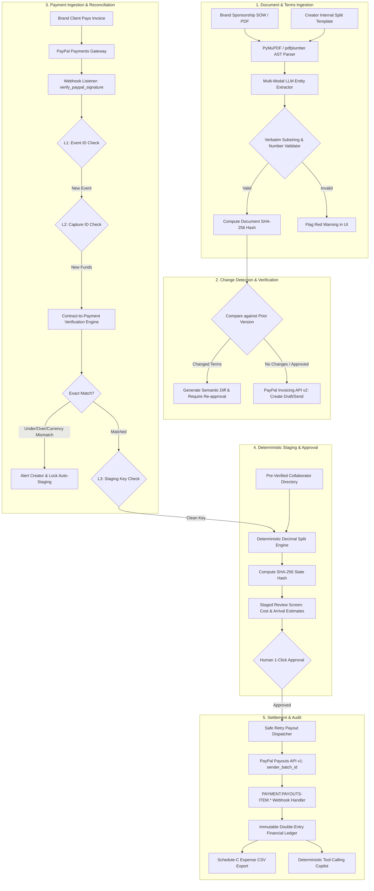
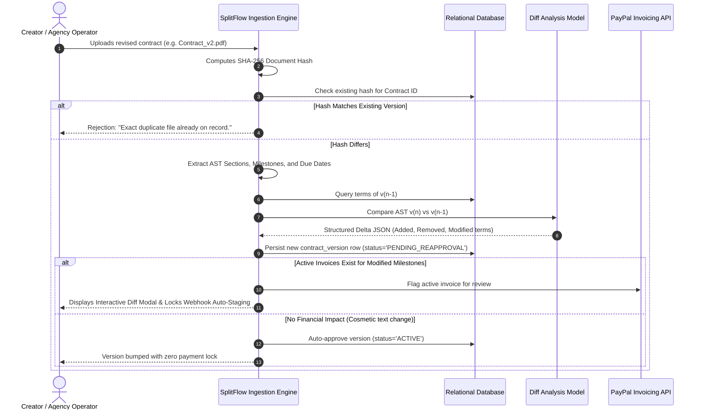
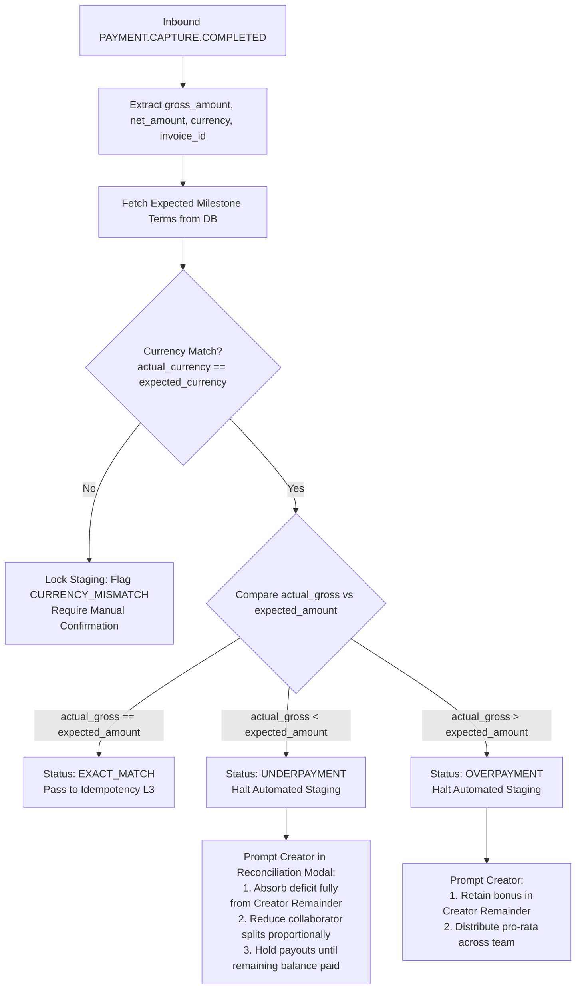
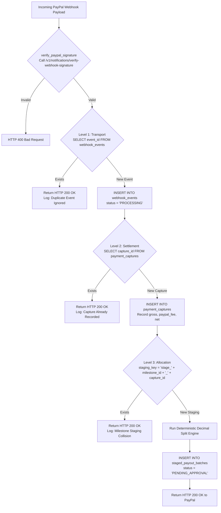
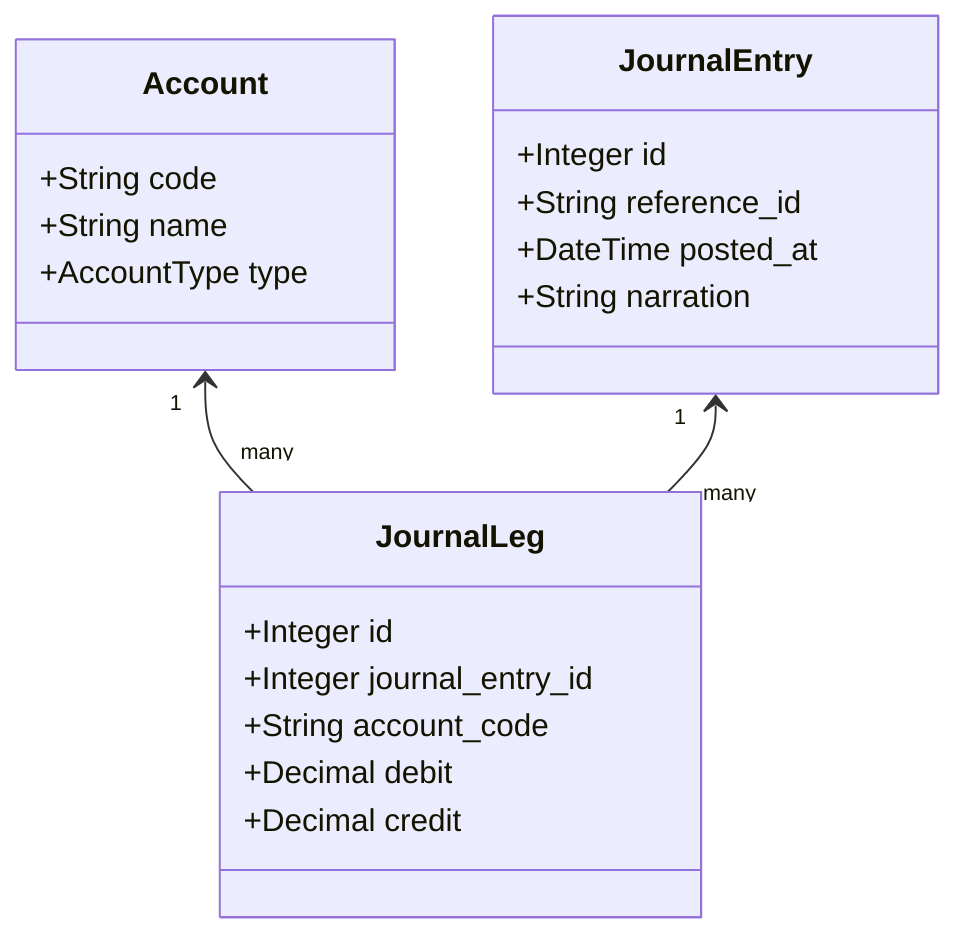
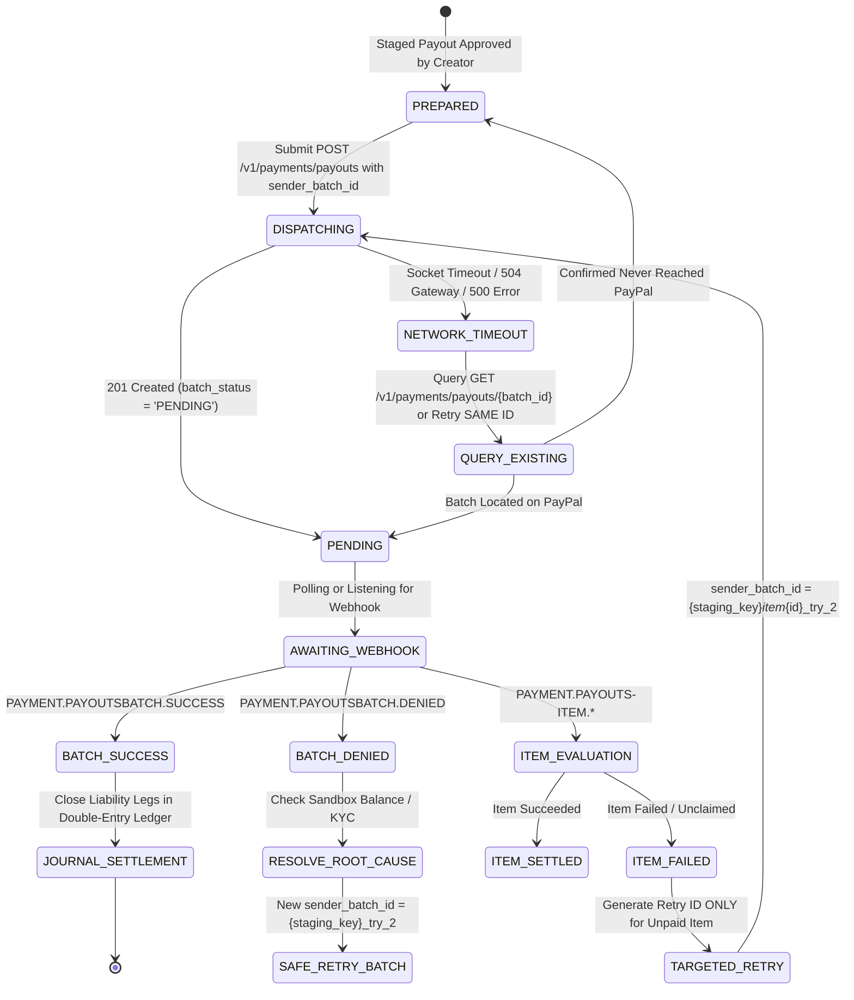
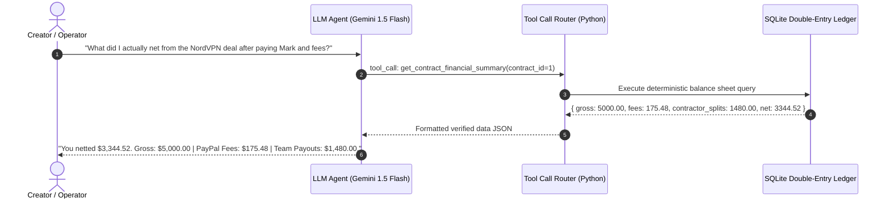

# SplitFlow AI — Production-Grade Implementation Plan (v3.0)

> **Document Version:** 3.0.0  
> **Target Platform:** PayPal Developer Platform & Multi-Modal AI  
> **Domain:** Agentic Commerce / Creator & Freelancer Cross-Border Finance  
> **Status:** Approved Architecture & Implementation Blueprint  

---

## Table of Contents
1. [Executive Summary & Core Value Proposition](#1-executive-summary--core-value-proposition)
2. [End-to-End System Architecture](#2-end-to-end-system-architecture)
3. [Component 1: Contract Versioning & Change Detection](#3-component-1-contract-versioning--change-detection)
4. [Component 2: Contract-to-Payment Verification Engine](#4-component-2-contract-to-payment-verification-engine)
5. [Component 3: Three-Level Idempotency & Deterministic Splits](#5-component-3-three-level-idempotency--deterministic-splits)
6. [Component 4: Immutable Double-Entry Financial Ledger](#6-component-4-immutable-double-entry-financial-ledger)
7. [Component 5: Resilient PayPal Payouts & Safe Retry State Machine](#7-component-5-resilient-paypal-payouts--safe-retry-state-machine)
8. [Component 6: Deterministic Tool-Calling Financial Copilot](#8-component-6-deterministic-tool-calling-financial-copilot)
9. [Complete Database Schema (SQL DDL)](#9-complete-database-schema-sql-ddl)
10. [PayPal Developer Platform Integration Matrix](#10-paypal-developer-platform-integration-matrix)
11. [Sandbox Setup & Testing Matrix](#11-sandbox-setup--testing-matrix)
12. [Phase-by-Phase Sprint Execution Plan](#12-phase-by-phase-sprint-execution-plan)
13. [Winning 3-Minute Demo Script & Storyboard](#13-winning-3-minute-demo-script--storyboard)
14. [Open Architectural Decisions & Clarifications](#14-open-architectural-decisions--clarifications)

---

## 1. Executive Summary & Core Value Proposition

### The Problem
Creators and independent creative agencies operate globally with international teams (e.g., video editors in the Philippines, thumbnail designers in Brazil, managers in the US). They face three compounding operational failures:
1. **The Contract Ingestion Gap:** Sponsorship agreements and Statements of Work (SOWs) arrive as unstructured PDFs. Manually tracking deliverables, milestone dates, and team revenue splits leads to missed payments and calculation disputes.
2. **The Execution & Security Risk:** Unsupervised LLMs cannot be trusted with raw financial credentials (prompt-injection risk, email hallucinations, arithmetic errors). Conversely, manually copy-pasting PayPal IDs and doing split math across multiple currencies is slow and error-prone.
3. **The Settlement & Audit Vacuum:** PayPal merchants struggle to reconcile partial payments, amended agreements, and net received balances after platform deductions. At tax time, creators receive gross 1099-K figures without structured records of international contractor deductions.

### The Solution: SplitFlow AI
SplitFlow AI is an **AI-assisted financial operations pipeline with human-in-the-loop governance**. It parses brand SOWs with verifiable source-text highlighting, reconciles incoming PayPal invoice settlements against contractual terms, computes deterministic milestone splits against actual net received funds, executes batch cross-border payouts via PayPal Payouts, and maintains an immutable double-entry ledger with an audit-ready Schedule-C expense export.

---

## 2. End-to-End System Architecture



---

## 3. Component 1: Contract Versioning & Change Detection



### Technical Specifications
1. **Document-Level Hash Assertion:**
   ```python
   def compute_pdf_hash(file_bytes: bytes) -> str:
       return hashlib.sha256(file_bytes).hexdigest()
   ```
2. **Source Highlighting & Substring Validation:**
   * **Engine:** `PyMuPDF` (`fitz`) or `pdfplumber` (extracts text bounding boxes `[x0, y0, x1, y1]`).
   * **Verification Algorithm:**
     ```python
     def verify_source_quote(extracted_text: str, source_quote: str, extracted_number: str) -> bool:
         normalized_doc = " ".join(extracted_text.split()).lower()
         normalized_quote = " ".join(source_quote.split()).lower()
         
         # Rule 1: Quote must exist verbatim in document
         if normalized_quote not in normalized_doc:
             return False
         # Rule 2: Extracted number must appear inside the quote
         if str(extracted_number) not in source_quote:
             return False
         return True
     ```
   * If verification fails, the UI replaces the green bounding box with a high-visibility **red alert badge**: `[Unverified Quote: Manual Verification Required]`.

---

## 4. Component 2: Contract-to-Payment Verification Engine

When a client pays an invoice, the funds arriving in the PayPal balance do not always match expected gross amounts due to wire deductions, partial settlements, or currency conversions.



### Discrepancy Matrix:
* **`EXACT_MATCH`:** Milestone gross matches capture gross. Staging continues automatically.
* **`UNDERPAYMENT`:** Capture gross is less than expected milestone amount. Automatic payout dispatch is blocked until the creator determines how the shortfall is absorbed.
* **`OVERPAYMENT`:** Client included a rush bonus or reimbursement. Staging is held until the creator confirms bonus allocation.
* **`CURRENCY_MISMATCH`:** Payment arrived in a non-contract currency. Staging is paused to prevent FX slippage.

---

## 5. Component 3: Three-Level Idempotency & Deterministic Splits



### Deterministic Split Engine Invariants
```python
from decimal import Decimal, ROUND_HALF_UP

def compute_splits_for_milestone(
    milestone_id: int,
    actual_net_received: Decimal,
    flat_splits: list,
    percent_splits: list,
    collaborator_directory: dict
) -> tuple[list, Decimal, Decimal]:
    """
    Guarantees that total payouts + creator remainder strictly equals actual_net_received.
    """
    # Step 1: Deduct assigned flat fees
    total_flat = sum(Decimal(str(item["flat_amount"])) for item in flat_splits)
    if total_flat > actual_net_received:
        raise ValueError("Flat fees exceed total net received funds.")
        
    net_pool = actual_net_received - total_flat
    
    staged_items = []
    total_collaborator_payouts = Decimal("0.00")
    
    # Process flat fee items
    for item in flat_splits:
        amt = Decimal(str(item["flat_amount"])).quantize(Decimal("0.01"), rounding=ROUND_HALF_UP)
        verified_email = collaborator_directory[item["collaborator_id"]]["email"]
        staged_items.append({
            "collaborator_id": item["collaborator_id"],
            "verified_email": verified_email,
            "amount": amt,
            "type": "FLAT"
        })
        total_collaborator_payouts += amt
        
    # Process percentage items against net pool
    for item in percent_splits:
        pct = Decimal(str(item["percentage"])) / Decimal("100")
        amt = (net_pool * pct).quantize(Decimal("0.01"), rounding=ROUND_HALF_UP)
        verified_email = collaborator_directory[item["collaborator_id"]]["email"]
        staged_items.append({
            "collaborator_id": item["collaborator_id"],
            "verified_email": verified_email,
            "amount": amt,
            "type": "PERCENT"
        })
        total_collaborator_payouts += amt

    # Step 2: Creator Remainder absorbs all leftover cents
    creator_remainder = actual_net_received - total_collaborator_payouts
    
    # Strict Invariant Assertion
    assert (total_collaborator_payouts + creator_remainder) == actual_net_received, "Invariant Broken!"
    assert total_collaborator_payouts <= actual_net_received, "Overdraft Protection Violation!"
    
    return staged_items, total_collaborator_payouts, creator_remainder
```

---

## 6. Component 4: Immutable Double-Entry Financial Ledger



### Chart of Accounts (COA)
| Code | Account Name | Type | Normal Balance | Purpose |
| :--- | :--- | :--- | :--- | :--- |
| `1010` | **PayPal Cash Balance** | Asset | Debit | Liquid funds currently residing in creator's PayPal account. |
| `1200` | **Accounts Receivable (Brand Invoices)** | Asset | Debit | Unpaid client invoices issued via PayPal Invoicing. |
| `2010` | **Collaborator Payouts Payable** | Liability | Credit | Staged, approved funds owed to team members awaiting batch settlement. |
| `4010` | **Gross Sponsorship Revenue** | Revenue | Credit | Top-line contractual revenue earned. |
| `5010` | **PayPal Inbound Processing Fees** | Expense | Debit | Merchant transaction processing fees deducted by PayPal. |
| `5020` | **PayPal Outbound Payout Fees** | Expense | Debit | Batch payout fees assessed on international and domestic transfers. |
| `3010` | **Creator Retained Profit** | Equity | Credit | Net earnings retained by creator after all contractor splits and fees. |

### Complete Accounting Lifecycle Example ($2,500 Milestone)

#### Transaction 1: Milestone Invoice Generated & Sent
* **Narration:** Issued PayPal Invoice #INV2-901 to NordVPN for Milestone 1.
* **Balanced Legs:**
  * `DR 1200 Accounts Receivable`: **\$2,500.00**
  * `CR 4010 Gross Sponsorship Revenue`: **\$2,500.00**

#### Transaction 2: Client Settlement (Inbound Capture)
* **Narration:** Client settled invoice via PayPal. Gross \$2,500.00; PayPal Fee \$87.74; Net \$2,412.26.
* **Balanced Legs:**
  * `DR 1010 PayPal Cash Balance`: **\$2,412.26**
  * `DR 5010 PayPal Inbound Processing Fees`: **\$87.74**
  * `CR 1200 Accounts Receivable`: **\$2,500.00**

#### Transaction 3: Milestone Split Allocation (Human Approval)
* **Narration:** Approved split: \$300 flat fee to Designer, 20% (\$422.45) to Editor.
* **Balanced Legs:**
  * `DR 4010 Gross Sponsorship Revenue (Contra)`: **\$722.45**
  * `CR 2010 Collaborator Payouts Payable`: **\$722.45**

#### Transaction 4: Batch Payout Execution & Settlement
* **Narration:** PayPal Payouts batch executed. \$722.45 disbursed + \$2.00 PayPal payout fee.
* **Balanced Legs:**
  * `DR 2010 Collaborator Payouts Payable`: **\$722.45**
  * `DR 5020 PayPal Outbound Payout Fees`: **\$2.00**
  * `CR 1010 PayPal Cash Balance`: **\$724.45**

---

## 7. Component 5: Resilient PayPal Payouts & Safe Retry State Machine



### The 30-Day Idempotent Safety Rules:
1. **Network Drops & Server Errors (5xx):**
   * Never generate a new `sender_batch_id`. Re-submit with the **exact same ID**. PayPal guarantees that duplicate submissions with the same batch ID within 30 days will not execute twice.
2. **Batch Rejections (e.g. `INSUFFICIENT_FUNDS`):**
   * Do not retry automatically. Require operator intervention (e.g. top up balance).
   * Increment attempt suffix only after root cause is resolved: `f"{staging_key}_try_2"`.
3. **Item-Level Failures:**
   * If 3 out of 4 collaborators are successfully paid, **do not re-dispatch the batch**.
   * Re-dispatch only the single failed recipient using an item-specific idempotency key: `f"{staging_key}_item_{item_id}_try_2"`.

---

## 8. Component 6: Deterministic Tool-Calling Financial Copilot



### Strict Tool Specification (Function Calling)
```python
COPILOT_TOOLS = [
    {
        "name": "get_contract_financial_summary",
        "description": "Returns gross invoiced, net received, contractor payouts, and retained earnings for a contract.",
        "parameters": {
            "type": "object",
            "properties": {
                "contract_id": {"type": "integer", "description": "The internal contract ID"}
            },
            "required": ["contract_id"]
        }
    },
    {
        "name": "get_collaborator_payout_history",
        "description": "Returns historical ledger payouts and pending balances for a specific collaborator.",
        "parameters": {
            "type": "object",
            "properties": {
                "collaborator_name": {"type": "string"},
                "start_date": {"type": "string", "description": "YYYY-MM-DD"},
                "end_date": {"type": "string", "description": "YYYY-MM-DD"}
            },
            "required": ["collaborator_name"]
        }
    },
    {
        "name": "get_reconciliation_discrepancies",
        "description": "Returns all payments with underpayments, overpayments, or currency mismatches.",
        "parameters": {"type": "object", "properties": {}}
    }
]
```

---

## 9. Complete Database Schema (SQL DDL)

```sql
-- ============================================================================
-- 1. CONTRACTS & VERSIONING
-- ============================================================================
CREATE TABLE contracts (
    id INTEGER PRIMARY KEY AUTOINCREMENT,
    client_name VARCHAR(150) NOT NULL,
    current_version INTEGER DEFAULT 1,
    status VARCHAR(50) DEFAULT 'ACTIVE',
    created_at TIMESTAMP DEFAULT CURRENT_TIMESTAMP
);

CREATE TABLE contract_versions (
    id INTEGER PRIMARY KEY AUTOINCREMENT,
    contract_id INTEGER NOT NULL,
    version_number INTEGER NOT NULL,
    document_hash VARCHAR(64) NOT NULL UNIQUE,
    raw_pdf_path VARCHAR(255) NOT NULL,
    parsed_terms JSON NOT NULL,
    diff_summary TEXT,
    requires_reapproval BOOLEAN DEFAULT FALSE,
    created_at TIMESTAMP DEFAULT CURRENT_TIMESTAMP,
    CONSTRAINT fk_cv_contract FOREIGN KEY (contract_id) REFERENCES contracts(id)
);

-- ============================================================================
-- 2. COLLABORATOR DIRECTORY (Anti-Hallucination & Anti-Injection)
-- ============================================================================
CREATE TABLE collaborators (
    id INTEGER PRIMARY KEY AUTOINCREMENT,
    full_name VARCHAR(150) NOT NULL,
    role VARCHAR(100) NOT NULL,
    verified_paypal_email VARCHAR(255) NOT NULL UNIQUE,
    country_code VARCHAR(5) DEFAULT 'US',
    default_payout_currency VARCHAR(10) DEFAULT 'USD',
    is_active BOOLEAN DEFAULT TRUE,
    created_at TIMESTAMP DEFAULT CURRENT_TIMESTAMP
);

-- ============================================================================
-- 3. MILESTONES & SPLIT PRESETS
-- ============================================================================
CREATE TABLE milestones (
    id INTEGER PRIMARY KEY AUTOINCREMENT,
    contract_id INTEGER NOT NULL,
    version_id INTEGER NOT NULL,
    description VARCHAR(255) NOT NULL,
    expected_amount DECIMAL(10, 2) NOT NULL,
    currency VARCHAR(10) DEFAULT 'USD',
    due_date DATE,
    paypal_invoice_id VARCHAR(100) UNIQUE,
    status VARCHAR(50) DEFAULT 'PENDING',
    CONSTRAINT fk_m_contract FOREIGN KEY (contract_id) REFERENCES contracts(id),
    CONSTRAINT fk_m_version FOREIGN KEY (version_id) REFERENCES contract_versions(id)
);

CREATE TABLE milestone_split_rules (
    id INTEGER PRIMARY KEY AUTOINCREMENT,
    milestone_id INTEGER NOT NULL,
    collaborator_id INTEGER NOT NULL,
    split_type VARCHAR(20) NOT NULL,             -- 'FLAT' or 'PERCENT'
    split_value DECIMAL(10, 2) NOT NULL,         -- Amount or Percentage (e.g. 20.00)
    CONSTRAINT fk_sr_milestone FOREIGN KEY (milestone_id) REFERENCES milestones(id),
    CONSTRAINT fk_sr_collab FOREIGN KEY (collaborator_id) REFERENCES collaborators(id)
);

-- ============================================================================
-- 4. THREE-LEVEL IDEMPOTENCY LEDGER
-- ============================================================================
CREATE TABLE webhook_events (
    event_id VARCHAR(100) PRIMARY KEY,          -- Level 1: PayPal WH-XXXXX
    event_type VARCHAR(100) NOT NULL,
    received_at TIMESTAMP DEFAULT CURRENT_TIMESTAMP,
    status VARCHAR(50) NOT NULL
);

CREATE TABLE payment_captures (
    capture_id VARCHAR(100) PRIMARY KEY,        -- Level 2: PayPal CAP-XXXXX
    invoice_id VARCHAR(100) NOT NULL,
    gross_amount DECIMAL(10, 2) NOT NULL,
    paypal_fee DECIMAL(10, 2) NOT NULL,
    net_amount DECIMAL(10, 2) NOT NULL,
    currency VARCHAR(10) NOT NULL,
    reconciliation_status VARCHAR(50) NOT NULL,  -- EXACT_MATCH, UNDERPAYMENT, OVERPAYMENT
    captured_at TIMESTAMP NOT NULL,
    created_at TIMESTAMP DEFAULT CURRENT_TIMESTAMP
);

CREATE TABLE staged_payout_batches (
    staging_key VARCHAR(150) PRIMARY KEY,       -- Level 3: "stage_{milestone_id}_{capture_id}"
    milestone_id INTEGER NOT NULL,
    capture_id VARCHAR(100) NOT NULL,
    state_hash VARCHAR(64) NOT NULL,            -- SHA-256 of staged items
    total_payout_amount DECIMAL(10, 2) NOT NULL,
    creator_remainder DECIMAL(10, 2) NOT NULL,
    sender_batch_id VARCHAR(150) UNIQUE,
    status VARCHAR(50) NOT NULL,                -- 'STAGED', 'APPROVED', 'DISPATCHED', 'SUCCESS', 'FAILED'
    created_at TIMESTAMP DEFAULT CURRENT_TIMESTAMP,
    CONSTRAINT fk_sb_capture FOREIGN KEY (capture_id) REFERENCES payment_captures(capture_id),
    CONSTRAINT fk_sb_milestone FOREIGN KEY (milestone_id) REFERENCES milestones(id)
);

CREATE TABLE staged_payout_items (
    id INTEGER PRIMARY KEY AUTOINCREMENT,
    staging_key VARCHAR(150) NOT NULL,
    collaborator_id INTEGER NOT NULL,
    verified_email VARCHAR(255) NOT NULL,
    amount DECIMAL(10, 2) NOT NULL,
    currency VARCHAR(10) NOT NULL,
    payout_item_id VARCHAR(100),                -- PayPal Item ID from Payouts response
    status VARCHAR(50) DEFAULT 'STAGED',        -- 'STAGED', 'SUCCESS', 'FAILED', 'UNCLAIMED'
    CONSTRAINT fk_spi_batch FOREIGN KEY (staging_key) REFERENCES staged_payout_batches(staging_key),
    CONSTRAINT fk_spi_collab FOREIGN KEY (collaborator_id) REFERENCES collaborators(id)
);

-- ============================================================================
-- 5. IMMUTABLE DOUBLE-ENTRY GENERAL LEDGER
-- ============================================================================
CREATE TABLE accounts (
    code VARCHAR(10) PRIMARY KEY,
    name VARCHAR(100) NOT NULL,
    type VARCHAR(20) NOT NULL
);

CREATE TABLE journal_entries (
    id INTEGER PRIMARY KEY AUTOINCREMENT,
    reference_id VARCHAR(100) NOT NULL,
    narration TEXT NOT NULL,
    posted_at TIMESTAMP DEFAULT CURRENT_TIMESTAMP
);

CREATE TABLE journal_legs (
    id INTEGER PRIMARY KEY AUTOINCREMENT,
    journal_entry_id INTEGER NOT NULL,
    account_code VARCHAR(10) NOT NULL,
    debit DECIMAL(10, 2) DEFAULT 0.00,
    credit DECIMAL(10, 2) DEFAULT 0.00,
    CONSTRAINT fk_jl_entry FOREIGN KEY (journal_entry_id) REFERENCES journal_entries(id),
    CONSTRAINT fk_jl_account FOREIGN KEY (account_code) REFERENCES accounts(code)
);
```

---

## 10. PayPal Developer Platform Integration Matrix

| Purpose | PayPal API Endpoint | HTTP Method | Payload / Response Handling |
| :--- | :--- | :--- | :--- |
| **Authentication** | `/v1/oauth2/token` | `POST` | Exchanges `Client_ID` + `Secret` for cached Bearer token (expires in 9 hours). |
| **Create Invoice** | `/v2/invoicing/invoices` | `POST` | Maps extracted contract milestone details to official PayPal invoice payload. |
| **Send Invoice** | `/v2/invoicing/invoices/{invoice_id}/send` | `POST` | Dispatches payment link to brand client email. |
| **Verify Webhook**| `/v1/notifications/verify-webhook-signature` | `POST` | Validates transmission ID, timestamp, webhook ID, and signature against PayPal cert. |
| **Batch Payouts** | `/v1/payments/payouts` | `POST` | Sends multi-item payout batch using 30-day idempotent `sender_batch_id`. |
| **Get Payout Status**| `/v1/payments/payouts/{payout_batch_id}` | `GET` | Queries batch status and individual item resolution (`SUCCESS`, `FAILED`, `UNCLAIMED`). |
| **Historical Reporting**| `/v1/reporting/transactions` | `GET` | Used by Copilot to audit raw transaction IDs and historical fee breakdowns. |

---

## 11. Sandbox Setup & Testing Matrix

To guarantee an airtight demo, configure exactly **5 sandbox accounts** on [developer.paypal.com](https://developer.paypal.com):

```
┌────────────────────────────────────────────────────────────────────────┐
│                        PAYPAL SANDBOX ACCOUNT TOPOLOGY                 │
├──────────────────────────┬──────────────────────────┬──────────────────┤
│ Role in SplitFlow        │ Sandbox Account Email    │ Type             │
├──────────────────────────┼──────────────────────────┼──────────────────┤
│ Creator (Merchant Lead)  │ creator-biz@sandbox.com  │ Business (Pro)   │
│ Brand Client (Payer)     │ brand-client@sandbox.com │ Personal / Biz   │
│ Video Editor (Manila)    │ editor-ph@sandbox.com    │ Personal         │
│ Thumbnail Artist (Brazil)│ designer-br@sandbox.com  │ Personal         │
│ Talent Manager (US)      │ manager-us@sandbox.com   │ Personal         │
└──────────────────────────┴──────────────────────────┴──────────────────┘
```

### Pre-Flight Verification Checklist:
* [ ] Log into `creator-biz@sandbox.com` $\rightarrow$ ensure **Payouts** is enabled in developer settings.
* [ ] Verify that `creator-biz@sandbox.com` has an active balance of at least \$2,000 USD to facilitate sandbox batch payouts.
* [ ] Ensure `brand-client@sandbox.com` is linked to a sandbox payment card with at least \$10,000 credit limit.
* [ ] Seed the `collaborators` database table with the verified emails of the 3 collaborator sandbox accounts.

---

## 12. Phase-by-Phase Sprint Execution Plan

```
┌─────────────────────────────────────────────────────────────────────────────┐
│ Day 1: Project Scaffold, SQLite Models & PayPal OAuth                       │
│ • Initialize FastAPI backend and Next.js 14 frontend                        │
│ • Apply SQL DDL migrations (Contracts, Collaborators, Ledger, Webhooks)     │
│ • Implement PayPal OAuth Token Manager with in-memory caching               │
├─────────────────────────────────────────────────────────────────────────────┤
│ Day 2: Ingestion, AST Extraction & Substring Validation                     │
│ • Implement PyMuPDF extractor with character bounding-box output            │
│ • Write Pydantic entity extraction prompt for Gemini 1.5 Flash              │
│ • Implement verbatim substring & number validation with red UI flags        │
├─────────────────────────────────────────────────────────────────────────────┤
│ Day 3: Contract Versioning & Semantic Diff Engine                           │
│ • Implement SHA-256 document hasher and duplicate rejection                 │
│ • Build AST milestone diffing engine (v(n) vs v(n-1))                       │
│ • Implement Reapproval Circuit Breaker for changed financial terms          │
├─────────────────────────────────────────────────────────────────────────────┤
│ Day 4: PayPal Invoicing & 3-Level Idempotent Capture                        │
│ • Build PayPal Invoicing v2 draft/send client                               │
│ • Build Webhook Signature Verification dependency                           │
│ • Implement Level 1 (Event), Level 2 (Capture), and Level 3 (Staging) gates │
│ • Build Contract-to-Payment Verification engine (under/overpayment alerts)  │
├─────────────────────────────────────────────────────────────────────────────┤
│ Day 5: Staged Approval, Resilient Payouts & Double-Entry Ledger             │
│ • Staged Payout Review Screen with SHA-256 state hash lock                  │
│ • Safe retry batch dispatcher (30-day idempotent sender_batch_id reuse)     │
│ • Listen to PAYMENT.PAYOUTS-ITEM.* webhooks and update item states          │
│ • Automate double-entry balanced journal entry creation                     │
├─────────────────────────────────────────────────────────────────────────────┤
│ Day 6: Copilot Function Calling, CSV Export & Demo Recording                │
│ • Implement Copilot tools over SQLite ledger (Zero arithmetic hallucination)│
│ • Add 1-click Schedule-C CSV export with "Not Tax Advice" disclaimer        │
│ • Record and edit 2:45 demo video following storyboard                      │
└─────────────────────────────────────────────────────────────────────────────┘
```

---

## 13. Winning 3-Minute Demo Script & Storyboard

* **[0:00 - 0:30] The Hook & Problem Statement:**
  * Screen: Messy PDF contract from a major brand + spreadsheet with split math errors.
  * Voiceover: *"Creators run global businesses with international teams, but contract management and cross-border team payouts are a chaotic mess of PDF parsing errors and manual calculations. Meet SplitFlow AI."*
* **[0:30 - 1:15] Contract Ingestion & Source Verification:**
  * Action: Drag and drop `NordVPN_Sponsorship_Agreement_v1.pdf`.
  * Screen: Instant side-by-side view. Extracted milestones appear on the right. Clicking *"Milestone 1 (\$2,500)"* highlights the exact verbatim clause in the PDF on the left.
  * Action: Show the Collaborator Directory auto-matching Mark Santos to `editor-ph@sandbox.com`. Click **"Create & Send PayPal Invoice"**.
* **[1:15 - 1:50] Payment Capture & Idempotent Staging:**
  * Action: Switch to Brand Client sandbox tab. Pay the \$2,500 PayPal invoice.
  * Screen: Webhook arrives in SplitFlow console. Show Level 1 and Level 2 idempotency validation logs.
  * Action: Show the **Staged Payout Review Screen**. The app calculated exact net amounts based on real received funds (\$2,412.26). Mark is allocated \$422.45, Designer \$300.00, Creator remainder \$1,689.81.
  * Callout: Highlight arrival and fee estimates clearly labeled with `[Estimated]`.
* **[1:50 - 2:25] Safe 1-Click Payout Execution & Ledger Update:**
  * Action: Click **"Approve & Dispatch Batch Payout"**.
  * Screen: PayPal Payouts API executes. Show PayPal Sandbox receipt notifications arriving in Editor's and Designer's accounts.
  * Action: Switch to the **Double-Entry Ledger UI**. Show balanced journal entries (Cash, AR, Revenue, Payable).
  * Action: Click **"Export Contractor Expense CSV"** and open the clean spreadsheet with the prominent *"Not Tax Advice"* header.
* **[2:25 - 2:45] Contract Amendment & Re-approval (The "Wow" Factor):**
  * Action: Upload `NordVPN_Sponsorship_Agreement_v2.pdf` where Milestone 2 was cut by \$500.
  * Screen: The system flags a bright yellow alert: *"Contract Amendment Detected: Milestone 2 reduced by \$500.00. Automatic staging paused until re-approved."*
* **[2:45 - 3:00] Copilot Tool Calling & Closing:**
  * Action: In Copilot chat, ask: *"What did I actually net on this project after team payouts and fees?"*
  * Screen: The Copilot runs `get_contract_financial_summary`, returns exact math (\$1,689.81) with zero hallucination.
  * Voiceover: *"SplitFlow transforms PayPal into the secure, audit-ready financial operating system for the global creator economy."*

---

## 14. Open Architectural Decisions & Clarifications

Before executing Phase 1 code generation, please confirm preferences on these two items:

1. **Underpayment Fallback Policy:**
   * **Recommended Default:** If a client underpays (e.g., sends \$2,400 instead of \$2,500 due to intermediary fees), SplitFlow **halts staging and alerts the creator** to decide whether to absorb the \$100 deduction from their remainder or deduct it pro-rata from the team.
   * *Alternative:* Automatically deduct shortfall from creator's remainder without pausing.
2. **Multi-Currency Payout Sandbox Display:**
   * **Recommended Default:** Dispatch payouts in **USD** across all sandbox accounts, displaying the disclaimer: *"Dispatched in USD; recipient's local PayPal account converts to PHP/BRL upon domestic withdrawal."* This avoids sandbox configuration issues with unlinked foreign bank simulations while maintaining 100% technical accuracy.

